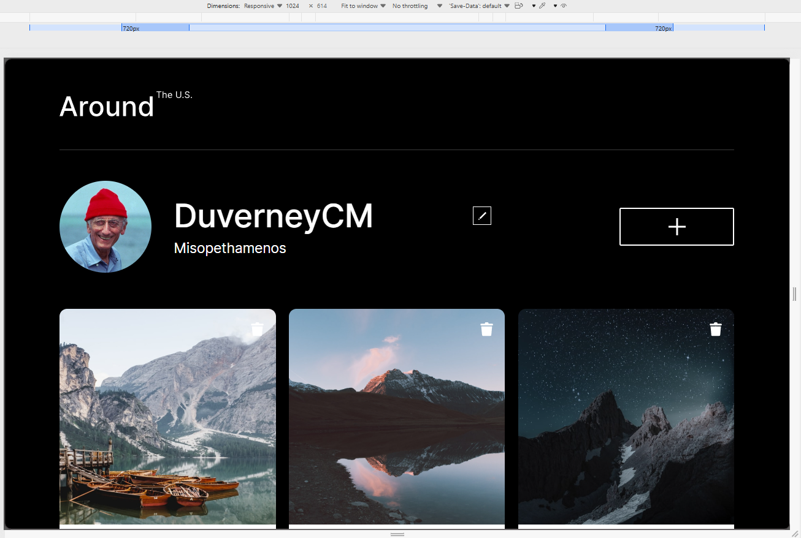
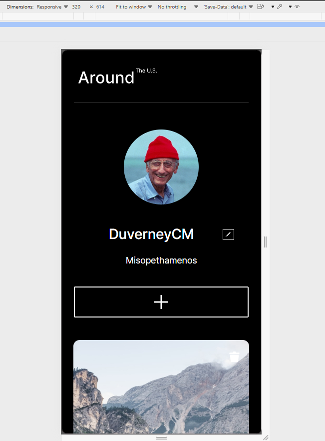

<!-- # Tripleten web_project_around_es -->

# TripleTen: Around The U.S. / Alrededor de EE.UU


## 📌 Descripción del Proyecto

**Around The U.S.** es una aplicación web interactiva y totalmente responsiva diseñada para compartir y explorar fotografías de lugares emblemáticos de Estados Unidos. Este proyecto forma parte del bootcamp de desarrollo web de **TripleTen**, enfocado en consolidar buenas prácticas de maquetación, diseño adaptable y manipulación del DOM con JavaScript.

La página permite a los usuarios personalizar su perfil (editar nombre e información personal), agregar nuevas tarjetas con imágenes y títulos de lugares, dar "me gusta" a las publicaciones y eliminar tarjetas existentes mediante ventanas modales interactivas. También permite ver las imagenes de las tarjetas ampliadas tras dar clic en ellas.

Por ahora, no hay backend, por lo que los cambios realizados por el usuario no se conservan.

---

## 🚀 Características Principales

- **Diseño Responsivo (Mobile-First):** Adaptado de manera fluida para dispositivos móviles, tabletas y ordenadores de escritorio.
- **Ventanas Modales Interactuantes:** Formularios emergentes para editar el perfil de usuario y añadir nuevas tarjetas fotográficas con transiciones suaves.
- **Interactividad con JavaScript:** Manipulación dinámica del DOM para usar agregar, eliminar y dar "me gusta" a tarjetas de forma eficiente, y editar información de perfil.
- **Estructura CSS Modular:** Uso de la metodología **BEM (Block, Element, Modifier)** y arquitectura de archivos organizada.
- **Flexbox y Grid CSS:** Diseños modernos para la galería y distribución de elementos.

---

## 🛠️ Tecnologías y Herramientas Utilizadas

- **HTML5:** Marcador semántico y estructurado. Las tarjetas se generan a partir de templates.
- **CSS3:** Estilos avanzados, Flexbox, CSS Grid y Media Queries.
- **JavaScript (Vanilla):** Lógica del cliente, manejo de eventos y manipulación del DOM.
- **Metodología BEM:** Para una nomenclatura limpia y mantenible en CSS.
- **Git y GitHub:** Control de versiones y despliegue del proyecto.

---

## 📸 Capturas de Pantalla

|                    Vista de Escritorio                     |                       Vista Móvil                        |
| :--------------------------------------------------------: | :------------------------------------------------------: |
| __ | __ |

---

## 🔗 Enlaces del Proyecto

- **Repositorio en GitHub:** [DuverneyCM/web_project_around_es](https://github.com/DuverneyCM/web_project_around_es)
- **Página en Vivo ( [GitHub Pages](https://duverneycm.github.io/web_project_around_es/index.html) ):**

---

## ⚙️ Cómo ejecutar el proyecto localmente

Si deseas clonar y probar este proyecto en tu máquina local, sigue estos pasos:

1. **Clona el repositorio:**

   ```bash
   git clone https://github.com/DuverneyCM/web_project_around_es.git
   ```

2. **Abre la carpeta del proyecto** en tu editor de código favorito (por ejemplo, [Visual Studio Code](https://code.visualstudio.com/)).

3. **Ejecuta el proyecto:** Puedes abrir directamente el archivo `index.html` en tu navegador web, O utilizar una extensión como **Live Server** en VS Code para una mejor experiencia de desarrollo con recarga automática.

---

## 💡 Author

- **[DuverneyCM, M.Eng](https://github.com/DuverneyCM)** - _Web Development, SoC-FPGA & Embedded Systems_

---

> _Proyecto desarrollado como parte del plan de estudios de TripleTen._  
> _Este archivo fue generado 95% por IA :)_
